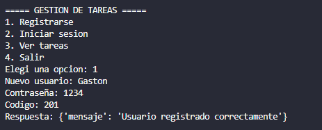
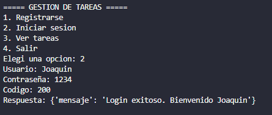
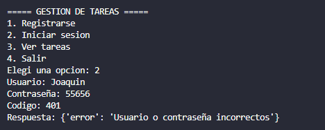
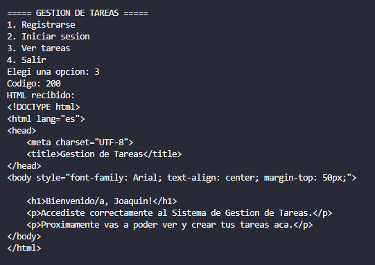
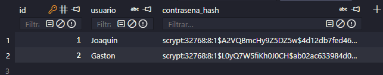

# PFO 2 - Sistema de Gestión de Tareas con API y Base de Datos

API REST hecha en **Python + Flask** que permite registrar usuarios, iniciar sesión y acceder a una página de tareas protegida. Los usuarios se guardan en **SQLite** con las contraseñas **hasheadas**.

## Estructura del proyecto

El código está dividido en módulos y cada archivo tiene una sola responsabilidad:

```
PFO2/
├── servidor.py          # Punto de entrada: crea la app Flask y la arranca
├── config.py            # Configuración (nombre de la base, host, puerto)
├── base_de_datos.py     # Conexión y consultas a SQLite
├── seguridad.py         # Hash y verificación de contraseñas
├── rutas/
│   ├── usuarios.py      # POST /registro y POST /login
│   └── tareas.py        # GET /tareas (protegido con autenticación básica)
├── templates/
│   └── tareas.html      # Página HTML de bienvenida
├── cliente.py           # Menú del cliente de consola
├── cliente_api.py       # Funciones que llaman a la API
└── requirements.txt     # Librerías necesarias
```

La base de datos `tareas.db` se crea sola al iniciar el servidor.

Las rutas se organizan con **Blueprints** de Flask: cada archivo de la carpeta `rutas/` define sus endpoints y `servidor.py` los registra en la aplicación.

## Instalación

1. Tener instalado Python 3.
2. Instalar las dependencias:

```bash
pip install -r requirements.txt
```

## Cómo ejecutar

**1. Iniciar el servidor** (dejar esta terminal abierta):

```bash
python servidor.py
```

El servidor queda escuchando en `http://127.0.0.1:5000`.

**2. Usar el cliente de consola** (en otra terminal):

```bash
python cliente.py
```

Aparece un menú para registrarse, iniciar sesión y ver las tareas.

## Endpoints

| Método | Ruta | Qué hace | Respuestas |
|---|---|---|---|
| POST | `/registro` | Registra un usuario. Body: `{"usuario": "nombre", "contraseña": "1234"}` | 201 creado · 400 faltan datos · 409 ya existe |
| POST | `/login` | Verifica usuario y contraseña | 200 OK · 400 faltan datos · 401 incorrecto |
| GET | `/tareas` | Muestra un HTML de bienvenida. Requiere **autenticación básica** | 200 OK · 401 sin acceso |

## Pruebas con curl

> En Windows, si la `ñ` da problemas en la consola, se puede enviar `"contrasena"` (sin ñ). El servidor acepta las dos formas.

```bash
# Registro
curl -X POST http://127.0.0.1:5000/registro -H "Content-Type: application/json" -d "{\"usuario\":\"juan\",\"contrasena\":\"1234\"}"

# Login
curl -X POST http://127.0.0.1:5000/login -H "Content-Type: application/json" -d "{\"usuario\":\"juan\",\"contrasena\":\"1234\"}"

# Tareas (con autenticación básica)
curl -u juan:1234 http://127.0.0.1:5000/tareas
```

También se puede abrir `http://127.0.0.1:5000/tareas` en el navegador: va a aparecer una ventana pidiendo usuario y contraseña.

## Capturas de pantalla


1. Registro exitoso: 
2. Login exitoso: 
3. Login con contraseña incorrecta: 
4. Página de tareas en el navegador: 
5. Contraseña hasheada en la base de datos: 

## Respuestas conceptuales

### ¿Por qué hashear contraseñas?

Un hash es una función de **un solo sentido**: a partir de la contraseña se obtiene un texto, pero no se puede volver atrás desde ese texto a la contraseña original. Por eso:

- Si alguien roba la base de datos, **no ve las contraseñas reales**, solo los hashes.
- Muchas personas usan la misma contraseña en varios sitios. Guardarla en texto plano pondría en riesgo también sus otras cuentas.
- Ni siquiera el administrador del sistema puede ver las contraseñas de los usuarios.
- Para el login no hace falta conocer la contraseña: se hashea lo que escribe el usuario y se compara con el hash guardado (`check_password_hash`).
- La librería `werkzeug.security` agrega una **sal** (*salt*) aleatoria a cada hash. Así, dos usuarios con la misma contraseña tienen hashes distintos, y eso evita ataques con tablas precalculadas (*rainbow tables*).

### Ventajas de usar SQLite en este proyecto

- **No necesita servidor**: la base es un solo archivo (`tareas.db`), no hay que instalar ni configurar nada aparte.
- **Viene incluido en Python** (módulo `sqlite3`), no requiere librerías extra.
- **Persistencia**: los datos no se pierden al apagar el servidor, a diferencia de guardarlos en una lista en memoria.
- **Usa SQL estándar**, así que lo aprendido sirve después para MySQL o PostgreSQL.
- Es **liviano y rápido**, ideal para proyectos chicos, prototipos y aprendizaje.
- Es fácil de **compartir y respaldar**: alcanza con copiar el archivo.

Como limitación, no está pensado para muchos usuarios escribiendo al mismo tiempo. Para un sistema grande convendría un motor como PostgreSQL.
